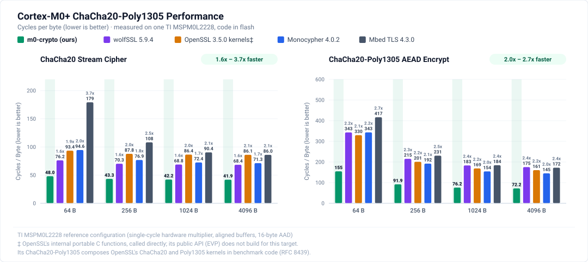
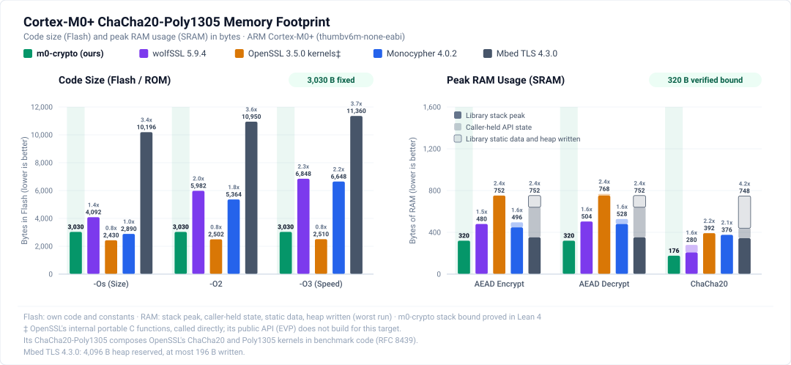
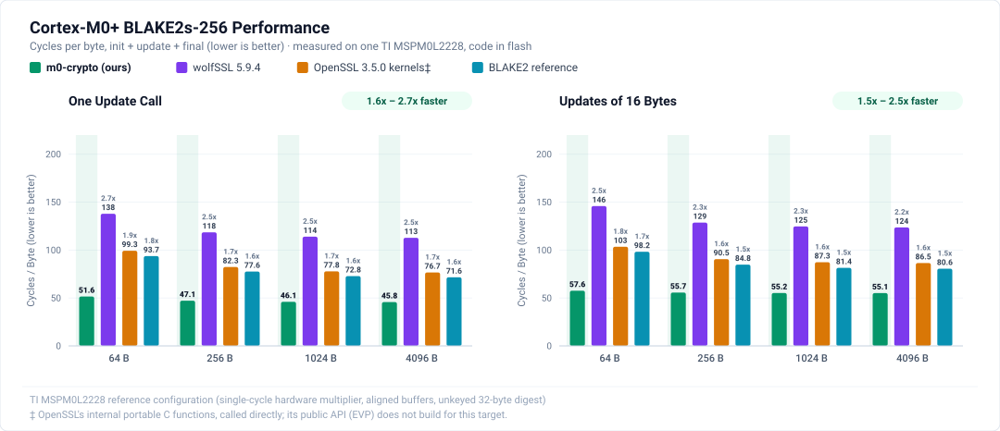
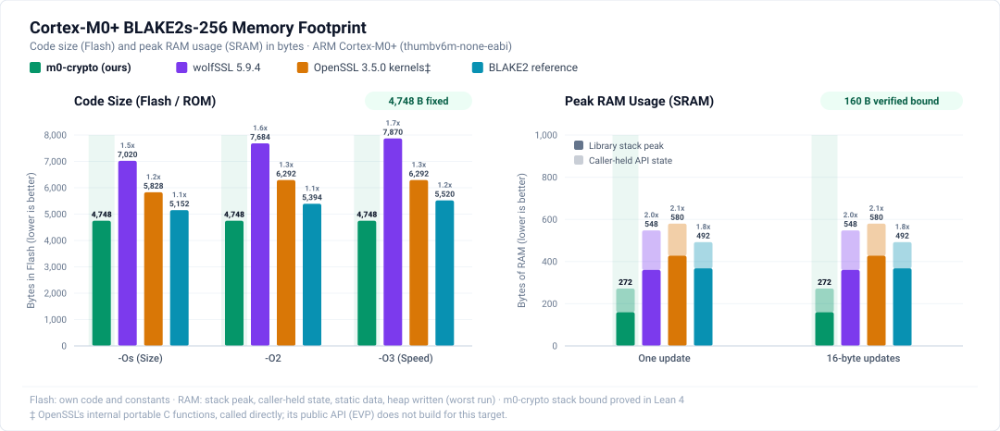
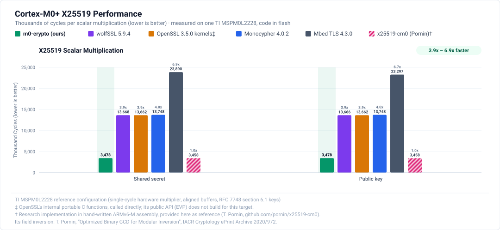
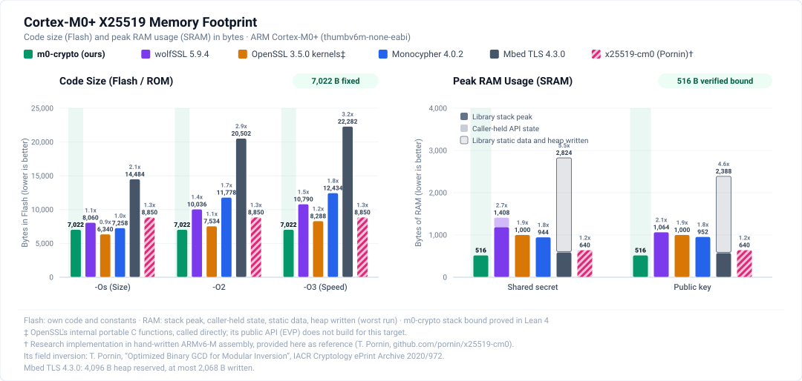

# m0-crypto

Optimized ARMv6-M assembly implementations of cryptographic primitives for Cortex-M0+ with formal verification in Lean 4.

Current version contains:

| Algorithm | Function | Header | Standard |
|---|---|---|---|
| [ChaCha20](https://en.wikipedia.org/wiki/ChaCha20-Poly1305) | `m0c_chacha20_xor` | [`chacha20.h`](include/m0crypto/chacha20.h) | [RFC 8439 §2.4](https://www.rfc-editor.org/rfc/rfc8439#section-2.4) |
| [ChaCha20-Poly1305](https://en.wikipedia.org/wiki/ChaCha20-Poly1305) | `m0c_chacha20poly1305_encrypt` / `_decrypt` | [`chacha20poly1305.h`](include/m0crypto/chacha20poly1305.h) | [RFC 8439 §2.8](https://www.rfc-editor.org/rfc/rfc8439#section-2.8) |
| [BLAKE2s-256](https://en.wikipedia.org/wiki/BLAKE_(hash_function)#BLAKE2) | `m0c_blake2s_init` / `_update` / `_final` | [`blake2s.h`](include/m0crypto/blake2s.h) | [RFC 7693](https://www.rfc-editor.org/rfc/rfc7693) |
| [X25519](https://en.wikipedia.org/wiki/Curve25519) | `m0c_x25519` | [`x25519.h`](include/m0crypto/x25519.h) | [RFC 7748 §5](https://www.rfc-editor.org/rfc/rfc7748#section-5) |

The headers document the buffer, aliasing and alignment rules. In short:

- **ChaCha20-Poly1305:** works in place. Decryption checks the tag before writing and leaves `out` unchanged on failure.
- **BLAKE2s-256:** `init`, `update`, `final` on a caller-held 112-byte context, which the caller wipes afterwards.
- **X25519:** `m0c_x25519(out, scalar, point)` per RFC 7748, with any alignment or overlap. It does not reject low-order points.

## Performance

Measured on a [TI MSPM0L2228](https://www.ti.com/product/MSPM0L2228) (Cortex-M0+, single-cycle multiplier).

The charts compare against portable C libraries and other optimized assembly implementations on the same board, code in flash (see [`bench/`](bench/README.md), [`bench/board/`](bench/board/README.md)). The C libraries are compiled with `-Os`.

### ChaCha20-Poly1305

**1.6-3.7x** fewer cycles than wolfSSL, the OpenSSL kernels, Monocypher and Mbed TLS for ChaCha20, and **2.0-2.7x** fewer for AEAD encryption.

<details>
<summary>📊 ChaCha20-Poly1305 performance and memory usage comparison</summary>





</details>

### BLAKE2s-256

**1.5-2.7x** fewer cycles than wolfSSL, the OpenSSL kernels and the BLAKE2 reference implementation.

<details>
<summary>📊 BLAKE2s-256 performance and memory usage comparison</summary>





</details>

### X25519

**3.9-6.9x** fewer cycles than the portable C libraries. Thomas Pornin's hand-written assembly, [x25519-cm0](https://github.com/pornin/x25519-cm0), takes 0.6% fewer cycles (3,458k against 3,478k).[^pornin]

<details>
<summary>📊 X25519 performance and memory usage comparison</summary>





</details>

[^pornin]: [x25519-cm0](https://github.com/pornin/x25519-cm0) inverts with Pornin's optimized binary GCD ([eprint 2020/972](https://eprint.iacr.org/2020/972)), 54,793 cycles according to its source. m0-crypto inverts with Fermat's little theorem, a chain of field squarings and multiplications. In the cycle model it costs 277,656 cycles, 8% of a call, and outside the inversion m0-crypto is about 5% faster than x25519-cm0. A GCD-style inversion such as safegcd would save about 5% of a call, but proving it needs the algorithm's iteration bound and a refinement of its batched matrix code, which by my estimation would roughly double the X25519 proofs. The Fermat chain reuses the already proved field multiply and square, so we accepted the slower inversion for a much smaller proof.

## Use

Each primitive ships as its own release archive. Take the ones you need, and `SHA256SUMS`, from the [GitHub releases](https://github.com/WeGoToMars/m0-crypto-lib/releases):

| Asset | Release archive | `.text` | Max stack |
|---|---|---:|---:|
| ChaCha20, ChaCha20-Poly1305 | `m0crypto-chacha20poly1305-*.tar.gz` | 3,030 B | 176 B (ChaCha20), 320 B (AEAD) |
| BLAKE2s-256 | `m0crypto-blake2s-*.tar.gz` | 4,748 B | 160 B |
| X25519 | `m0crypto-x25519-*.tar.gz` | 7,022 B | 516 B |

0. Check the downloads:

   ```sh
   shasum -a 256 -c --ignore-missing SHA256SUMS    # Linux: sha256sum -c --ignore-missing SHA256SUMS
   ```

1. Unpack each archive into its own folder in your project:

   ```sh
   mkdir -p third_party/m0crypto-chacha20poly1305
   tar xzf m0crypto-chacha20poly1305-*.tar.gz --strip-components=1 -C third_party/m0crypto-chacha20poly1305
   ```

   The folder holds `include/m0crypto/*.h`, `lib/libm0crypto_chacha20poly1305.a`, `src/`, `LICENSE` and `MANIFEST.txt`, which records the build hashes and the proofs commit whose theorems state the claims.

2. Link it. With CMake:

   ```cmake
   foreach(asset chacha20poly1305 blake2s x25519)    # the assets you unpacked
     add_library(m0crypto::${asset} STATIC IMPORTED)
     set_target_properties(m0crypto::${asset} PROPERTIES
       IMPORTED_LOCATION ${CMAKE_SOURCE_DIR}/third_party/m0crypto-${asset}/lib/libm0crypto_${asset}.a
       INTERFACE_INCLUDE_DIRECTORIES ${CMAKE_SOURCE_DIR}/third_party/m0crypto-${asset}/include)
   endforeach()
   target_link_libraries(app PRIVATE m0crypto::chacha20poly1305)
   ```

   In another build system or IDE, add the `include/` folder to the include path and the `.a` file to the linker inputs. Build your firmware for Cortex-M0+ (`-mcpu=cortex-m0plus -mthumb`). The library needs no heap, static data, C library or relocation, so it runs from flash or SRAM.

3. Call it:

   ```c
   #include "m0crypto/chacha20poly1305.h"

   /* Encrypt in place: buf holds len bytes of plaintext, then the ciphertext. */
   m0c_chacha20poly1305_encrypt(buf, tag, buf, len, aad, aad_len, key, nonce);

   /* Decrypt in place: if the tag is wrong, buf is left unchanged. */
   if (m0c_chacha20poly1305_decrypt(buf, tag, buf, len, aad, aad_len, key, nonce) != M0C_OK) {
       /* reject the message */
   }
   ```

4. Follow the rules in each header. Leave the stack space listed above, do not let buffers partly overlap, never reuse a nonce with the same key, wipe the BLAKE2s context after use, and reject low-order X25519 points if your protocol requires it.

To assemble the code in your own build instead, use `src/m0crypto_ASSET_text.s` from the archive. Any ARM assembler (clang or GNU `as`) turns it into the same machine code. GNU `as` appends one Thumb NOP, which no call reaches, when the size is 2 mod 4.

## Build from source

```sh
tools/build_lib.sh            # all assets, or name them: tools/build_lib.sh x25519
```

The script requires clang/LLVM 23.1.4 on `PATH`, refuses any other version and writes `build/lib/ASSET/libm0crypto_ASSET.a` with its `MANIFEST.txt`. The proofs cover exactly this build: `text_sha256` in `MANIFEST.txt` must match the SHA-256 listed in [`proofs/README.md`](proofs/README.md#release-assets). The release archives contain the same build.

`tools/release.py` builds the release archives and checks them against the proofs. CI ([`.github/workflows/ci.yml`](.github/workflows/ci.yml)) builds the assets, runs the QEMU tests, builds the archives, runs `proofs/tools/check.sh` and `proofs/tools/comparator.sh`, and runs the three mutation scripts of `proofs/tools`.

## Test

```sh
tools/test_qemu.sh            # all assets, or name them
```

Builds a test image for each asset from its release source and runs it on QEMU's Cortex-M0 (QEMU 11.1.3) against RFC, Wycheproof, pyca/cryptography and `hashlib` vectors, including unaligned and overlapping buffers. The images that `proofs/tools/check.sh` single-steps must contain the release `.text`. It also checks callee-saved registers and stack depth, and for ChaCha20-Poly1305 and X25519 the cleared registers and stack bytes.

## Proofs and Scope

Lean 4 proofs in [`proofs/`](proofs/) cover the exact machine code of each release build. For every exported function they prove that it:

- **Is correct:** returns the result specified by RFC 8439, RFC 7693 or RFC 7748, for any length, alignment and allowed buffer overlap.
- **Is memory-safe:** reads only its buffers, its code and its stack, writes only its buffers and its stack, stays within the stack size above, and restores SP and r4-r11.
- **Runs in constant time:** its instructions and memory addresses depend only on public inputs such as pointers and lengths.
- **Leaves no secrets:** after a call that runs without interruption, no key, message or other secret stays on the stack it used or in r0-r3 and r12. [`proofs/README.md`](proofs/README.md) lists which bytes and registers are zero.

Each header states the C caller contract and guarantees (conventions in [`docs/HEADERS.md`](docs/HEADERS.md)); [`proofs/README.md`](proofs/README.md) gives the machine-level preconditions, interrupt model and exact postconditions.

The proofs assume that the buffers are ordinary RAM that nothing else (such as DMA) writes during the call, and that execution time depends only on the instructions and addresses, which the board tests in [`bench/board/`](bench/board/README.md) check for BLAKE2s and X25519. Theorem names and exact statements are in [`proofs/README.md`](proofs/README.md).

```sh
git clone --recurse-submodules https://github.com/WeGoToMars/m0-crypto-lib
proofs/tools/check.sh              # every asset; requires Lean v4.35.0 (elan), LLVM 23.1.4, QEMU 11.1.3
proofs/tools/check.sh blake2s      # one asset
```

`check.sh` rebuilds each object, checks its bytes against the proofs, builds the proofs, audits their axioms and compares the Lean model with QEMU after every instruction a call can execute.

> [!IMPORTANT]
> Physical side channels (power analysis, fault injection) are out of scope. Callers keep nonces unique per key, reject low-order X25519 points where their protocol requires it, and wipe the BLAKE2s context.

## License

Original code is MIT licensed. Test-vector provenance and third-party license notices are documented in [THIRD_PARTY.md](THIRD_PARTY.md).
