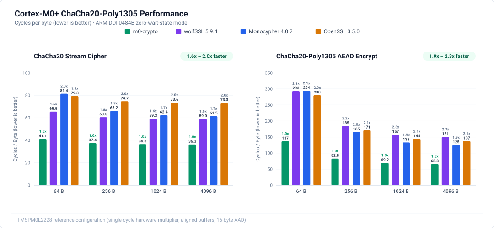

# m0-crypto

Fastest possible implementations of cryptographic primitives for Cortex-M0+ with formal verification in Lean 4.

Current version contains:

| Function | Header | Standard |
|---|---|---|
| `m0c_chacha20_xor` | [`chacha20.h`](include/m0crypto/chacha20.h) | [RFC 8439 §2.4](https://www.rfc-editor.org/rfc/rfc8439#section-2.4) |
| `m0c_chacha20poly1305_encrypt` / `_decrypt` | [`chacha20poly1305.h`](include/m0crypto/chacha20poly1305.h) | [RFC 8439 §2.8](https://www.rfc-editor.org/rfc/rfc8439#section-2.8) |

The headers serve as the API reference for buffer, aliasing, and alignment rules. Encryption and decryption operate in place (`out == in`). Decryption verifies the authentication tag before writing plaintext and leaves `out` unmodified on failure.

## Performance

### ChaCha20-Poly1305

m0-crypto achieves approximately 2x better performance than existing libraries across both ChaCha20 and ChaCha20-Poly1305.



> Note: None of the libraries tested provide an optimized assembly implementation, only portable C.

## Reference Hardware: TI MSPM0L2228

The reference microcontroller for this library is the [Texas Instruments MSPM0L2228](https://www.ti.com/product/MSPM0L2228), an Arm Cortex-M0+ microcontroller running up to 32 MHz with 256 KB flash and 32 KB SRAM. Several platform-specific properties directly inform this implementation and its benchmark model.

### Single-Cycle Hardware Multiplier

The Cortex-M0+ core offers two silicon configuration options for multiplication: a fast 1-cycle multiplier or a compact 32-cycle iterative multiplier. The MSPM0L2228 integrates the 1-cycle hardware multiplier, executing 32×32-bit `muls` in a single clock cycle. This is foundational for m0-crypto's Poly1305 engine, which decomposes each 32×29-bit limb product into four 16×16 `muls` operations without requiring a 64-bit multiplier.

### Zero-Wait-State SRAM and Flash Memory Hierarchy

The device provides 32 KB SRAM starting at `0x20000000` with single-cycle, zero-wait-state access across the full 32 MHz range. Embedded flash (256 KB) operates with zero wait states up to 24 MHz and introduces one wait state at 32 MHz, mitigated by a built-in flash prefetch buffer. Because the library requires zero static RAM (`.data`/`.bss`), has no relocations, and occupies only 3,030 bytes of `.text`, it can execute directly from either flash or SRAM.

### Hardware Cycle Counts

Benchmarked on physical MSPM0L2228 silicon running at 32 MHz, ChaCha20-Poly1305 AEAD executes in approximately 72 cycles per byte for 4,096-byte messages running from flash. Cycle counts measured via on-chip hardware timers were confirmed constant across varying keys, nonces, and payload data for accepted calls.

## Build

```sh
tools/build_lib.sh speed
```

This writes `build/lib/speed/libm0crypto.a` and `MANIFEST.txt` (recording artifact hashes and toolchain metadata). It requires clang/LLVM 23.1.4 (see `tools/versions.txt`); set `LLVM_BIN` if LLVM is not in `/opt/homebrew/opt/llvm/bin`. Version 0.1 supports the `speed` profile.

Link `libm0crypto.a` and add `include/` to your compiler's include path. The library has no dynamic allocation, no static data, no relocations, and no external dependencies. Code size is 3,030 bytes. Peak stack usage is at most 176 bytes for ChaCha20 and 320 bytes for AEAD.

## Test

```sh
tools/test_qemu.sh
```

Runs the library on QEMU's Cortex-M0 against [RFC 8439](https://www.rfc-editor.org/rfc/rfc8439), Wycheproof, and pyca/cryptography vectors (QEMU 11.1.3). The test harness validates functional correctness; it does not measure execution timing.

## Proofs and Scope

Functional proofs in [Lean 4](proofs/) verify the exact 3,030-byte release binary against [RFC 8439](https://www.rfc-editor.org/rfc/rfc8439) under an ARMv6-M machine model:

- ChaCha20 output correctness and counter-overflow rejection.
- Poly1305 modular arithmetic and compose operations (init, blocks, finish).
- AEAD encryption ciphertext and authentication tags.
- Checked decryption: tag verification prior to plaintext writes, leaving output unchanged on authentication failure.
- Memory safety: writes strictly confined to the output buffer, tag, and allocated stack frame.
- ABI compliance: complete restoration of SP and callee-saved registers, plus zeroing of key-derived working state on the stack.

The proofs cover arbitrary buffer lengths and byte alignments, including exact in-place operation (`out == in`). The execution model assumes ordinary memory without interrupts, concurrent memory modifications, or injected faults.

Constant-time trace proofs, read-address bounds, and intermediate stack-pointer bounds are planned for a subsequent release. Physical side-channel resistance (power analysis, fault injection) is out of scope. Callers are responsible for maintaining nonce uniqueness per key.

## Cycle Comparison

See [bench/README.md](bench/README.md) for the Cortex-M0+ cycle-count harness comparing m0-crypto, wolfSSL, Monocypher, and OpenSSL.

## Verifying the Proofs

The proofs are maintained in a git submodule:

```sh
git clone --recurse-submodules <this repository>
proofs/tools/check.sh      # requires Lean v4.35.0 (elan), LLVM 23.1.4, QEMU
```

The verification script rebuilds the library, confirms that its `.text` matches the release binary (`text_sha256` in `MANIFEST.txt`), builds all Lean proofs, and audits axioms.

## License

Original code is MIT licensed. Test-vector provenance and third-party license notices are documented in [THIRD_PARTY.md](THIRD_PARTY.md).
