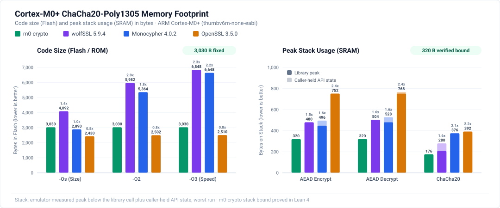
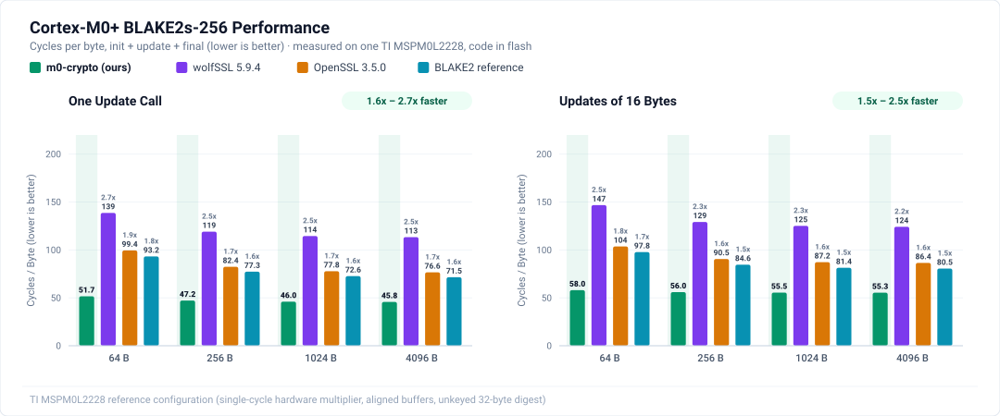
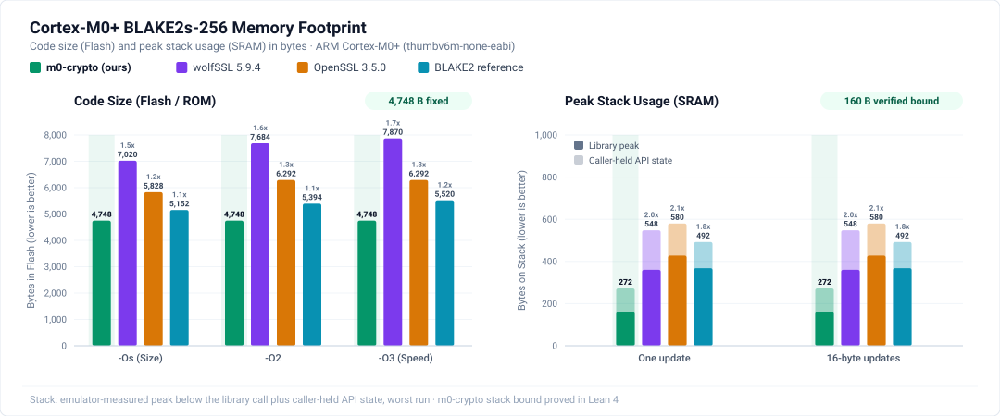
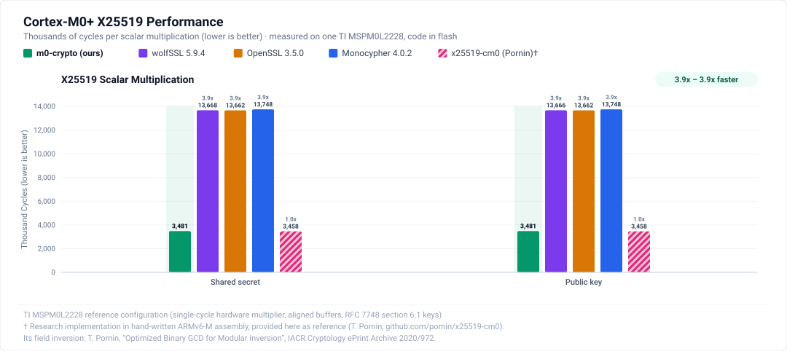
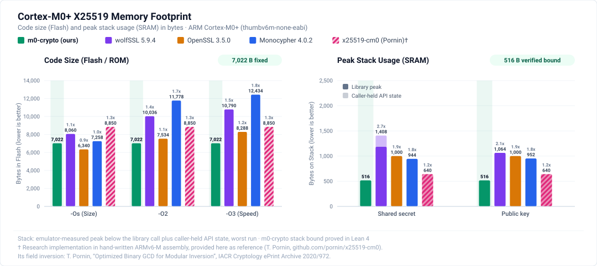

# m0-crypto

Optimized ARMv6-M assembly implementations of cryptographic primitives for Cortex-M0+ with formal verification in Lean 4.

Current version contains:

| Algorithm | Function | Header | Standard |
|---|---|---|---|
| [ChaCha20](https://en.wikipedia.org/wiki/ChaCha20-Poly1305) | `m0c_chacha20_xor` | [`chacha20.h`](include/m0crypto/chacha20.h) | [RFC 8439 §2.4](https://www.rfc-editor.org/rfc/rfc8439#section-2.4) |
| [ChaCha20-Poly1305](https://en.wikipedia.org/wiki/ChaCha20-Poly1305) | `m0c_chacha20poly1305_encrypt` / `_decrypt` | [`chacha20poly1305.h`](include/m0crypto/chacha20poly1305.h) | [RFC 8439 §2.8](https://www.rfc-editor.org/rfc/rfc8439#section-2.8) |
| [BLAKE2s-256](https://en.wikipedia.org/wiki/BLAKE_(hash_function)#BLAKE2) | `m0c_blake2s_init` / `_update` / `_final` | [`blake2s.h`](include/m0crypto/blake2s.h) | [RFC 7693](https://www.rfc-editor.org/rfc/rfc7693) |
| [X25519](https://en.wikipedia.org/wiki/Curve25519) | `m0c_x25519` | [`x25519.h`](include/m0crypto/x25519.h) | [RFC 7748 §5](https://www.rfc-editor.org/rfc/rfc7748#section-5) |

The headers serve as the API reference for buffer, aliasing, and alignment rules. In short:

- **ChaCha20-Poly1305.** Encryption and decryption operate in place (`out == in`). Decryption verifies the authentication tag before writing plaintext and leaves `out` unmodified on failure.
- **BLAKE2s-256.** Unkeyed incremental hashing with a 32-byte digest: `init`, any number of `update` calls, then `final`, on a caller-held, word-aligned 112-byte context. Context, input and output must be disjoint. Input and output may have any alignment, and an empty update may pass `NULL`. `final` consumes the context, so call `init` again before reusing it. The library does not check the total length, which the caller keeps below 2^64 bytes. The caller wipes the context afterwards, because it still holds the chain value and up to 64 message bytes.
- **X25519.** `m0c_x25519(out, scalar, point)` computes the RFC 7748 function. The scalar is clamped and bit 255 of the point is masked inside the call. It always returns `M0C_OK` and does not check for a low-order point or an all-zero result. A protocol that needs that check does it on the output. The three buffers may have any alignment and may overlap in any way.

## Performance

### ChaCha20-Poly1305

m0-crypto achieves approximately 2x better performance than existing libraries across both ChaCha20 and ChaCha20-Poly1305.




> Note: None of the libraries tested provide an optimized assembly implementation, only portable C.

### BLAKE2s-256

In the cycle model, m0-crypto takes 1.4x to 2.4x fewer cycles than wolfSSL, the BLAKE2 reference implementation and OpenSSL. This holds for one update call and for 16-byte updates, from 64 to 4,096 bytes.





> Note: The three comparators are portable C.

### X25519

In the cycle model, one scalar multiplication takes 3,289,592 cycles counted from the benchmark's C wrapper (the `m0c_x25519` call alone: 3,289,572), the same for every tested input. Thomas Pornin's hand-written Cortex-M0 assembly, [x25519-cm0](https://github.com/pornin/x25519-cm0), takes 3,229,917 cycles, 1.8% fewer. It also uses 640 bytes of stack against 516, and 8,850 bytes of flash against 7,022.

The portable C implementations take about 3.5x more cycles.





> Note: These BLAKE2s and X25519 figures come from the instruction-cost model in `bench/`, not from hardware, and compare implementations under the same model only. Board measurements are in [Hardware Cycle Counts](#hardware-cycle-counts) below; they are higher than these figures, and the receipts in `bench/board/` compare them with the model.

## Reference Hardware: TI MSPM0L2228

The reference microcontroller for this library is the [Texas Instruments MSPM0L2228](https://www.ti.com/product/MSPM0L2228), an Arm Cortex-M0+ microcontroller running up to 32 MHz with 256 KB flash and 32 KB SRAM. Several platform-specific properties directly inform this implementation and its benchmark model.

### Single-Cycle Hardware Multiplier

The Cortex-M0+ core offers two silicon configuration options for multiplication: a fast 1-cycle multiplier or a compact 32-cycle iterative multiplier. The MSPM0L2228 integrates the 1-cycle hardware multiplier, executing 32×32-bit `muls` in a single clock cycle. This is foundational for m0-crypto's Poly1305 engine, which decomposes each 32×29-bit limb product into four 16×16 `muls` operations without requiring a 64-bit multiplier.

### Zero-Wait-State SRAM and Flash Memory Hierarchy

The device provides 32 KB SRAM starting at `0x20000000` with single-cycle, zero-wait-state access across the full 32 MHz range. Embedded flash (256 KB) operates with zero wait states up to 24 MHz and introduces one wait state at 32 MHz, mitigated by a built-in flash prefetch buffer. Because each asset requires zero static RAM (`.data`/`.bss`), has no relocations, and occupies 3,030 (ChaCha20-Poly1305), 4,748 (BLAKE2s) or 7,022 (X25519) bytes of `.text`, it can execute directly from either flash or SRAM.

### Hardware Cycle Counts

ChaCha20-Poly1305 was not measured on the board for this release; its figures are the model figures in the charts above.

BLAKE2s and X25519 were measured on 2026-11-13 on one MSPM0L2228 LaunchPad at the reset-default clock setup (frequency and supply voltage not measured), with SysTick counting CPU cycles, for the unmodified release objects. Receipts, raw logs and limits are in [`bench/board/`](bench/board/README.md):

| Call | From flash | From SRAM | Source |
|---|---:|---:|---|
| `m0c_x25519`, one call | 3,480,832 cycles | 3,453,749 cycles | [`receipt-x25519.md`](bench/board/receipt-x25519.md) |
| `m0c_blake2s_update`, 4,096 bytes, aligned | 184,335 cycles | | [`receipt-blake2s.md`](bench/board/receipt-blake2s.md) |
| `m0c_blake2s_final` (after a block-aligned update) | 2,980 cycles | | same |
| BLAKE2s, 4,096 bytes in one update, through a C wrapper | 45.76 cycles/byte | 45.05 cycles/byte | same |

For X25519 every timed call took the same number of cycles, over 44 scalar and point pairs (RFC vectors, degenerate scalars, low-order and out-of-range points, random values), four buffer layouts and five repeats. For BLAKE2s the counts were the same across five message contents for every tested length and input offset. They depend on the length, the input offset and how the message is split into updates, which are public. These are measurements of the tested inputs on one board at one clock, not proofs. The measured stack high-water marks (516 bytes for X25519, 4 and 160 bytes for BLAKE2s) matched the proved bounds.

## Build

```sh
tools/build_lib.sh
```

Each primitive is its own independently released asset, a relocation-free unit with its own proofs:

| Asset | Source | Archive | `.text` |
|---|---|---|---|
| ChaCha20, ChaCha20-Poly1305 | `src/m0crypto_chacha20poly1305.S` | `build/lib/chacha20poly1305/libm0crypto_chacha20poly1305.a` | 3,030 bytes |
| BLAKE2s-256 | `src/m0crypto_blake2s.S` | `build/lib/blake2s/libm0crypto_blake2s.a` | 4,748 bytes |
| X25519 | `src/m0crypto_x25519.S` | `build/lib/x25519/libm0crypto_x25519.a` | 7,022 bytes |

`tools/build_lib.sh` builds all three (or the assets named as arguments); each directory also holds `text.bin`, the verified bytes, and `MANIFEST.txt` (artifact hashes and toolchain metadata). It requires clang/LLVM 23.1.4 (see `tools/versions.txt`). Set `LLVM_BIN` if LLVM is not in `/opt/homebrew/opt/llvm/bin`.

Link the archives of the assets you use and add `include/` to your compiler's include path. The library has no dynamic allocation, no static data, no relocations, and no external dependencies. Peak stack usage below the caller's SP is at most 176 bytes for ChaCha20, 320 bytes for AEAD, 4 bytes for `m0c_blake2s_init`, 160 bytes for `m0c_blake2s_update` and `m0c_blake2s_final`, and 516 bytes for X25519.

## Test

```sh
tools/test_qemu.sh
```

Runs each asset's release object on QEMU's Cortex-M0 (QEMU 11.1.3); `tools/test_qemu.sh ASSET...` selects assets:

- **ChaCha20-Poly1305** (`tests/test_chacha20.c`, `tests/test_aead.c`): [RFC 8439](https://www.rfc-editor.org/rfc/rfc8439), Wycheproof and pyca/cryptography vectors, callee-saved registers, the stack depth, and the stack bytes and registers left zero after a call (including the nested ChaCha20 and Poly1305 frames and r12).
- **BLAKE2s** (`tests/test_blake2s.c`): `hashlib.blake2s` digests at 204 lengths (0 to 200, 1,024, 1,025 and 4,096 bytes), at input and output offsets 0 to 3, in one update and in chunks of 1 to 200 bytes with empty `NULL` updates between them, callee-saved registers, SP and the stack depth.
- **X25519** (`tests/test_x25519.c`): 524 vectors (2 from RFC 7748 §5.2, 4 from §6.1 and 518 from Wycheproof, including low-order points) and the §5.2 iteration after 1 and 1,000 steps. `-DX25519_ITER_1M` adds the 1,000,000-step iteration, which is not run by default. The image also checks all alignments of the three pointers, the allowed overlaps, guard bytes, callee-saved registers, the registers and stack bytes the header says are cleared, and the stack depth.

The tests validate functional behaviour on an emulator; they do not measure execution timing.

## Proofs and Scope

Machine-checked proofs in [Lean 4](proofs/) are about the exact `.text` bytes of each release object (the `text_sha256` in its `MANIFEST.txt`), run in a Lean model of the ARMv6-M instructions they use. Each claim assumes a valid call: the preconditions listed in each header ("Preconditions of the proofs"), the AAPCS entry state, buffers that do not wrap around memory or overlap the code or the stack window, and a return address outside the library. The claims, per exported function:

- **Functional correctness.** ChaCha20 and ChaCha20-Poly1305 match [RFC 8439](https://www.rfc-editor.org/rfc/rfc8439) for any length and byte alignment, including in place. Decryption verifies the tag before writing plaintext and leaves `out` unchanged on failure. X25519 matches [RFC 7748](https://www.rfc-editor.org/rfc/rfc7748) for any alignment and overlap of its buffers. BLAKE2s `init`, `update` and `final` each match a streaming description of [RFC 7693](https://www.rfc-editor.org/rfc/rfc7693), and a composed theorem shows that `init`, any number of `update` calls and `final` write the BLAKE2s-256 digest of the concatenated inputs. Every valid call returns.
- **Memory and ABI safety.** Writes stay inside the caller's output buffers (and, for BLAKE2s, the context) and the stack window. Reads stay inside the inputs, the code and the stack window. SP and r4-r11 are restored. Proved stack bounds: 176 bytes (ChaCha20), 320 (AEAD), 4 (`m0c_blake2s_init`), 160 (`m0c_blake2s_update`, `m0c_blake2s_final`), 516 (X25519).
- **Constant-time traces.** In the model, the executed instructions and the data access addresses depend only on public inputs: pointers, lengths, the stack pointer, the code address and the return address. ChaCha20 adds the counter, decryption adds whether the tag verified, and BLAKE2s `update` and `final` add the number of bytes pending in the context, which is a function of the lengths. They do not depend on keys, nonces, messages, scalars, points or the hash state. A composed theorem extends this to a whole BLAKE2s hash.
- **Clearing.** ChaCha20 zeroes the 140 bytes of its stack frame below the saved registers for an accepted non-empty call. The AEAD functions zero 96 bytes of their own frame and return with r1-r3 zero. X25519 returns with r0-r3 and r12 zero and zeroes the 480 stack bytes below its saved registers. BLAKE2s `update` and `final` return with r0-r3 zero, and the internal compression routine zeroes its 100 bytes of working state. The caller wipes the BLAKE2s context.

The proofs assume sequential execution in ordinary memory without interrupts, concurrent memory modification, or hardware faults. An interrupt during a call pushes registers below the stack window, outside what the clearing statements cover. Core execution time is assumed to depend only on the instruction and address trace (as on the Cortex-M0+, which has no cache or branch prediction). This is tested through cycle measurements on one MSPM0L2228 (above), not proved. Cycle counts, whether modelled or measured, are not part of the proofs. See [proofs/README.md](proofs/README.md) for the theorem names and [proofs/docs/REVIEW.md](proofs/docs/REVIEW.md) for the exact statements, the trusted definitions and the limits of each asset.

> [!IMPORTANT]
> Physical side-channel resistance (power analysis, fault injection) is out of scope. Callers are responsible for maintaining nonce uniqueness per key, for rejecting low-order X25519 points where their protocol requires it, and for wiping the BLAKE2s context.

## Cycle Comparison

See [bench/README.md](bench/README.md) for the Cortex-M0+ cycle-count harness. It compares m0-crypto with wolfSSL, Monocypher and OpenSSL, plus the BLAKE2 reference implementation for BLAKE2s and x25519-cm0 for X25519.

## Verifying the Proofs

The proofs are maintained in a git submodule:

```sh
git clone --recurse-submodules <this repository>
proofs/tools/check.sh              # every asset; requires Lean v4.35.0 (elan), LLVM 23.1.4, QEMU 11.1.3
proofs/tools/check.sh blake2s      # one asset
```

For each asset, the verification script rebuilds the object, confirms that its `.text` matches the bytes the proofs are about, builds the asset's Lean proofs, audits their axioms, compares the claim statements with the checked-in baseline, runs the QEMU tests, and compares the Lean model with QEMU instruction by instruction on sampled calls (for X25519, on sampled windows of one call).

## License

Original code is MIT licensed. Test-vector provenance and third-party license notices are documented in [THIRD_PARTY.md](THIRD_PARTY.md).
