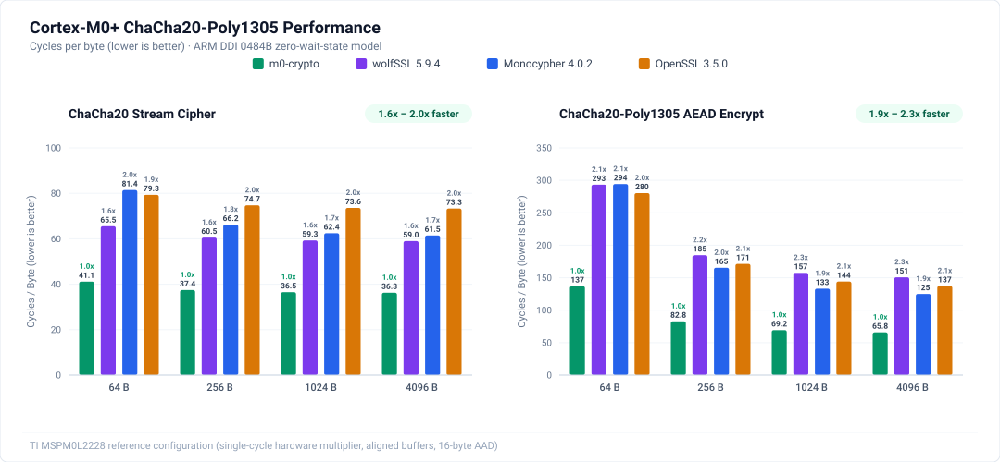
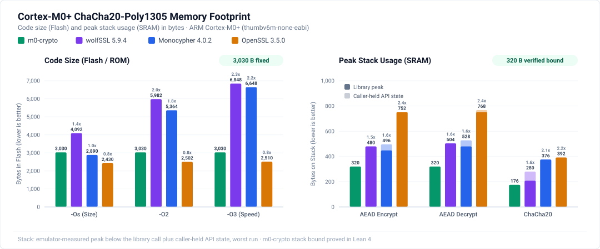
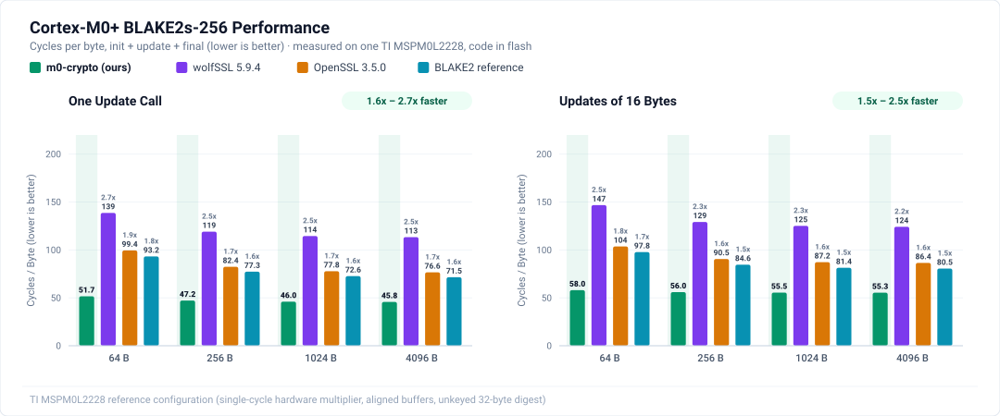
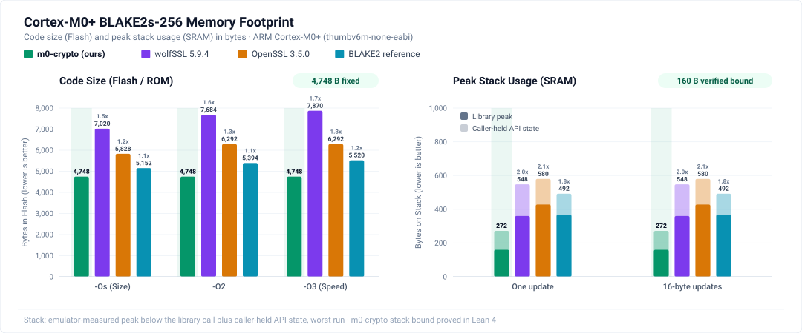
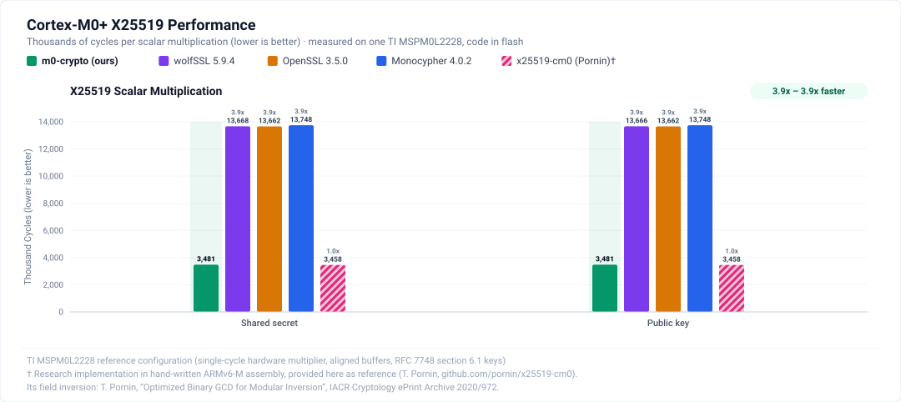
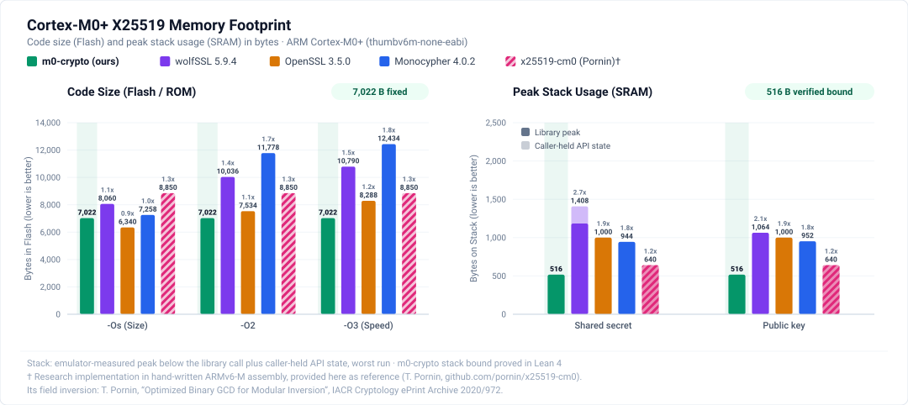

# Cortex-M0+ cycle comparison








The benchmark suite builds one comparison image per release asset and evaluates each image's calls in an emulator:

- **ChaCha20-Poly1305:** one-shot ChaCha20 and ChaCha20-Poly1305 operations, comparing m0-crypto, wolfSSL, Monocypher and OpenSSL portable kernels.
- **BLAKE2s-256:** unkeyed hashing, comparing m0-crypto, wolfSSL, the BLAKE2 reference implementation and OpenSSL.
- **X25519:** scalar multiplication, comparing m0-crypto, Thomas Pornin's x25519-cm0, wolfSSL, Monocypher and OpenSSL.

From the library root:

```sh
python3 bench/build.py chacha20poly1305     # or blake2s, x25519
uv run --no-project bench/count.py chacha20poly1305
```

This needs:

- Python 3, git and `uv`
- network access on the first build
- LLVM/LLD 23.1.4 on `PATH`.

`BENCH_OPT=-O2` or `-O3` sets the C optimization level; the default is `-Os` for every C comparator. `tools/build_lib.sh` builds the m0-crypto object of the asset.

Each build records wolfSSL's effective backend macros in `wolfssl-backend.txt` and `manifest.json`. No blanket assembly-disable macro is set.

- **ChaCha20-Poly1305:** on this target wolfSSL selects `POLY130532` and `WORD64_AVAILABLE`, without `WOLFSSL_W64_WRAPPER` or `WOLFSSL_ARMASM`. SP Math and Fast Math select public-key arithmetic and do not alter these ChaCha20/Poly1305 kernels.
- **BLAKE2s:** the image defines `HAVE_BLAKE2S`.
- **X25519:** the image defines `HAVE_CURVE25519`, plus `WC_NO_HASHDRBG` because the image has no random number generator. wolfSSL then uses its default 32-bit field code, `fe_operations.c`.

The build fetches source files pinned by revision and SHA-256 in `sources.lock.json`, plus a clean wolfSSL checkout pinned by commit in `build.py`. Sources and upstream licenses reside in the ignored `bench/third_party/`. Comparison images are separate from the release library.

## Code layout

- `build.py`: per-primitive configuration, source fetching, compilation, linking, code-size accounting and manifest generation.
- `count.py`: workload generation, correctness verification, and CSV/JSON output.
- `chart.py`: SVG summary charts, with one implementation order, name and color in every chart; m0-crypto is highlighted, and research implementations in assembly (x25519-cm0) are hatched and cited in a footnote. Cycles come from the board and stack from `count.py`; code sizes are hand-entered constants, taken for BLAKE2s and X25519 from the `code_bytes` of the build manifests.
- `armv6m.py`: Unicorn/Capstone execution harness, memory layout and instruction-cost model.
- `reference.py`: independent Python calculations used to verify every call. They cover [RFC 8439](https://www.rfc-editor.org/rfc/rfc8439), [RFC 7693](https://www.rfc-editor.org/rfc/rfc7693) and [RFC 7748](https://www.rfc-editor.org/rfc/rfc7748).
- `harness/`: one wrapper per implementation and operation (`run_IMPL_OP`). The wrappers share one argument block (`harness/job.h`).
- `compat/`: freestanding libc stubs and the OpenSSL declarations its unmodified sources expect.
- `runtime.c`, `lmul.S`: memory routines, OpenSSL's portable `CRYPTO_memcmp`, and the ARM EABI 64-bit multiply helper that portable C needs. Their execution costs are included.
- `link.ld`: comparison image linker script.

Each call is validated against the Python reference, and the reference is checked against its RFC's test vectors first. No result file is written until every call passes. Key setup, context initialization and wrapper overhead are included in every count.

## ChaCha20-Poly1305 workloads

Default lengths are 0, 64, 256, 1024 and 4096 bytes with 16-byte AAD and aligned, disjoint buffers. Each implementation runs four operations:

- ChaCha20 (counter 1)
- AEAD encrypt
- AEAD decrypt
- rejection of a modified tag.

The reference is checked against the [RFC 8439 §2.8.2](https://www.rfc-editor.org/rfc/rfc8439#section-2.8.2) vector.

```sh
# Alignment and block-boundary checks
uv run --no-project bench/count.py chacha20poly1305 \
  --lengths 0 1 15 16 17 63 64 65 --alignments a u ip
```

Buffer modes:

- `a`: aligned disjoint buffers.
- `u`: unaligned pointers (input+1, output+3).
- `ip`: exact in-place buffers (`out == in`).

`--aad-length` accepts 0..64; message lengths accept 0..4096.

Implementations:

- **m0c:** the released assembly object.
- **wolf:** wolfSSL v5.9.4-stable, portable C, one-shot public APIs.
- **mono:** Monocypher 4.0.2. ChaCha20 uses `crypto_chacha20_ietf`. Each AEAD call uses a fresh `crypto_aead_init_ietf` context; context update and wipe are included.
- **ossl:** OpenSSL 3.5.0 `ChaCha20_ctr32` and `Poly1305_*`, with [RFC 8439](https://www.rfc-editor.org/rfc/rfc8439) composition in `harness/chacha20poly1305.c`. Compatibility headers provide identity conversions; upstream kernel sources are unmodified.

## BLAKE2s workloads

Default lengths are 0, 64, 256, 1024 and 4096 bytes in aligned buffers; each call produces an unkeyed 32-byte digest. Each implementation runs two operations, both from init through final on a context the wrapper holds:

- `hash`: one update call.
- `stream`: updates of 16 bytes.

The reference is checked against [RFC 7693 appendix B](https://www.rfc-editor.org/rfc/rfc7693#appendix-B).

```sh
# Alignment and block-boundary checks
uv run --no-project bench/count.py blake2s \
  --lengths 0 1 15 16 17 63 64 65 128 129 --alignments a u
```

Implementations:

- **m0c:** the released assembly object (`m0c_blake2s_init`, `_update`, `_final`).
- **wolf:** wolfSSL v5.9.4-stable `wc_InitBlake2s`, `wc_Blake2sUpdate`, `wc_Blake2sFinal`.
- **ref:** the [BLAKE2 reference implementation](https://github.com/BLAKE2/BLAKE2) `ref/blake2s-ref.c`. Its functions are renamed with a `ref_` prefix by a forced include (`compat/blake2_ref_names.h`) because wolfSSL exports the same names.
- **ossl:** OpenSSL 3.5.0 provider-internal `ossl_blake2s_init`, `_update`, `_final` from `blake2s_prov.c`, without EVP dispatch.

## X25519 workloads

The default inputs are the [RFC 7748 §6.1](https://www.rfc-editor.org/rfc/rfc7748#section-6.1) keys. Each implementation runs two operations:

- `shared`: Alice's scalar with Bob's public key.
- `public`: Alice's scalar with the base point.

The scalar is passed clamped and the points have bit 255 clear. X25519 clamps and masks anyway, and wolfSSL's key import requires it. The reference is checked against [RFC 7748 §5.2](https://www.rfc-editor.org/rfc/rfc7748#section-5.2) and §6.1.

```sh
# Extra seeded pseudo-random shared-secret inputs, both alignments
uv run --no-project bench/count.py x25519 --random 2 --alignments a u
```

Implementations:

- **m0c:** the released assembly object (`m0c_x25519`).
- **pornin:** [x25519-cm0](https://github.com/pornin/x25519-cm0) by Thomas Pornin (MIT), hand-written ARMv6-M assembly, `x25519()`. Its assembly file is one section, so it is linked whole. Its README reports 3,229,950 cycles measured on an Atmel SAM D20 at 8 MHz; the model gives 3,229,917 for the shared-secret call.
- **wolf:** wolfSSL v5.9.4-stable public API:
  - shared secret: `wc_curve25519_import_private_ex`, `wc_curve25519_import_public_ex` and `wc_curve25519_shared_secret_ex` on two key objects (caller-held state)
  - public key: `wc_curve25519_make_pub`.
- **mono:** Monocypher 4.0.2 `crypto_x25519` and `crypto_x25519_public_key`.
- **ossl:** OpenSSL 3.5.0 `ossl_x25519` from `crypto/ec/curve25519.c`, without EVP dispatch, for both operations (the public key is `ossl_x25519` on the base point). On this 32-bit target it uses the base 2^25.5 field code.
  - Its `ossl_x25519_public_from_private` is not used. That function multiplies on the Edwards curve with a 30,720-byte precomputed table, and no build option removes the table; with the function, OpenSSL's public key took 3.8M modeled cycles and 40 KB of flash.
  - The Ed25519 functions in the same file are dropped by `--gc-sections`; their EVP declarations come from `compat/`.

## Counts and artifacts

`build/bench/PRIMITIVE/` contains `bench.elf`, `bench.map`, `manifest.json`, `cycles.csv` and `cycles.json`. `count.py` writes `bench/charts/PRIMITIVE/size_summary.svg`. The cycle charts `cycles_summary.svg` show board counts and come from `board/compare_summary.py --charts`.

The manifests record:

- source hashes and compiler flags
- the release text hash and the linked ELF hash
- each comparator's linked code bytes (`code_bytes`)
- the workloads and emulator versions
- the source hashes of the counter scripts.

The CSV reports executed instructions and these measures:

- `zero_wait_cycles`: Cortex-M0+ instruction costs from [ARM DDI 0484B, table 3-1](https://documentation-service.arm.com/static/60411742ee937942ba3016f2). The model selects the single-cycle multiplier and ordinary AHB memory accesses.
- `sram_store_model_cycles`: the same total plus one cycle per store transfer, including PUSH and STM elements.
- `peak_stack_bytes`: the deepest stack below the entry SP of any function the wrapper calls; the wrapper's own frame is excluded. The run fails if m0-crypto exceeds its Lean-proved bound: 320 bytes for ChaCha20-Poly1305, 160 for BLAKE2s, 516 for X25519.
- `caller_state_bytes`: state the public API requires the caller to hold on its stack, declared as `caller_state_*` in the harness. The stack chart stacks it on `peak_stack_bytes`. It covers:
  - `sizeof(ChaCha)` for wolfSSL ChaCha20
  - `sizeof(crypto_aead_ctx)` for Monocypher AEAD
  - the 16-byte computed tag in the OpenSSL decrypt composition
  - each BLAKE2s context (plus OpenSSL's parameter block)
  - wolfSSL's two X25519 key objects.

`code_bytes` sums the linked `.text` and `.rodata` input sections of each comparator's own objects after `--gc-sections`, excluding the harness and the shared runtime. The ChaCha20-Poly1305 chart's OpenSSL figures predate this accounting and also include the harness composition (2,430 bytes at `-Os`, against 2,020 for the kernels alone).

Unicorn executes the instructions and the Python hook assigns modeled costs. These metrics are instruction-cost model estimates without flash wait-states, cache or bus contention.

The same objects also ran on one MSPM0L2228 at the reset-default clock, code in flash, through the same wrappers ([`board/`](board/README.md)). The board counts are 3-23% above the zero-wait model and 1-7% above the model plus one cycle per store.

## Licenses

The harness is MIT licensed. Fetched sources keep their upstream licenses:

- wolfSSL: GPL-3.0/commercial
- Monocypher: BSD-2-Clause/CC0
- OpenSSL: Apache-2.0
- BLAKE2 reference: CC0/OpenSSL/Apache-2.0
- x25519-cm0: MIT.

The comparison ELFs include wolfSSL; keep its license materials with any distributed comparison build. The release archive contains only m0-crypto code.
